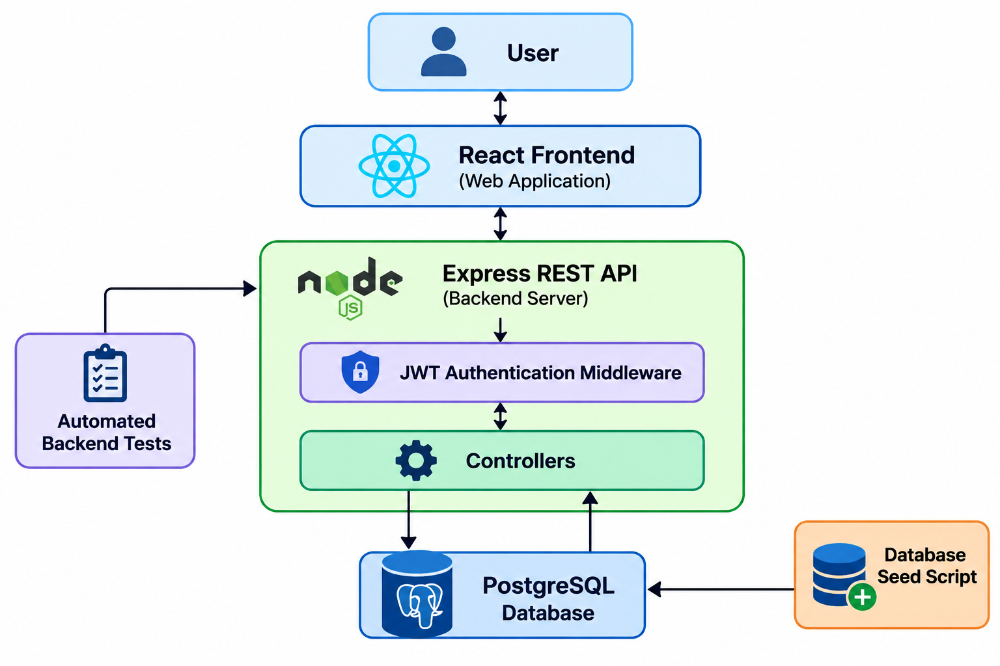

# Sweety – Blood Glucose Tracker

Sweety is a web-based blood glucose tracking application designed to help users record, manage, and monitor their blood glucose readings. It provides a centralized platform where users can maintain daily glucose records and understand their glucose trends through reports and statistics.

## Features

### 1. User Authentication
- User registration with name, email, and password.
- Secure password hashing using bcrypt.
- Login authentication using JSON Web Tokens (JWT).
- Protected routes accessible only to authenticated users.
- Users can access only their own glucose readings.

### 2. Glucose Reading Management
- Add, view, edit, and delete glucose readings.
- Record glucose values in mg/dL.
- Select a date and one of four daily time slots:
  - Morning (fasting)
  - After breakfast
  - After lunch
  - After dinner

**Validation Rules:**
- Glucose value is required.
- Values must be whole numbers between 40 and 600 mg/dL.
- Only one reading is allowed per time slot per day.
- A maximum of four readings is allowed per day.
- Future dates are not permitted.

### 3. Dashboard
- View glucose reading summaries.
- Monitor recent glucose readings.
- Access reading management and reports.
- Navigate through application features using the dashboard.

### 4. Reports and Statistics

The application provides three types of reports.

**Daily Report**
- View readings for a selected date.
- Display highest, lowest, and average glucose values.
- Display the total number of readings.
- View individual readings and their time slots.

**Month-to-Date Report**
- View readings from the first day of the selected month through the selected date.
- Display summary statistics.

**Monthly Report**
- View readings for the complete previous calendar month.
- Display summary statistics.

Average glucose values are displayed up to one decimal place.

## Technology Stack

| Category | Technologies |
|---|---|
| Frontend | React.js, Vite, CSS |
| Backend | Node.js, Express.js |
| Database | PostgreSQL |
| Authentication | JWT, bcryptjs |
| API Testing | Supertest, Node.js Test Runner |
| Version Control | Git, GitHub |

## System Architecture

Sweety follows a client-server architecture in which the React frontend communicates with the Express backend through REST APIs. The backend handles authentication, validation, application logic, and database operations.



### Architecture Components

- **Frontend:** Provides the user interface and communicates with backend APIs.
- **Backend:** Handles authentication, glucose reading operations, validation, and report generation.
- **Authentication Middleware:** Verifies JWT tokens before allowing access to protected endpoints.
- **PostgreSQL Database:** Stores user information and glucose readings.
- **Automated Tests:** Verify important API responses, authentication, and input validation.
- **Seed Script:** Creates a demo user and sample glucose readings.

## Project Structure

```text
sweety-glucose-tracker/
│
├── backend/
│   ├── database/
│   │   ├── schema.sql
│   │   └── seed.js
│   │
│   ├── src/
│   │   ├── config/
│   │   ├── controllers/
│   │   ├── middleware/
│   │   ├── routes/
│   │   ├── app.js
│   │   └── server.js
│   │
│   ├── tests/
│   │   └── app/
│   │       └── test.js
│   │
│   ├── .env.example
│   ├── package.json
│   └── package-lock.json
│
├── frontend/
│   ├── src/
│   ├── .env.example
│   ├── package.json
│   └── package-lock.json
│
└── README.md
```

## Installation and Setup

### Prerequisites

Make sure the following are installed:

- Node.js
- npm
- PostgreSQL database or Neon PostgreSQL account
- Git

### 1. Clone the Repository

```bash
git clone https://github.com/eswaralakshmi26/sweety-glucose-tracker
```

Navigate into the project directory:

```bash
cd sweety-glucose-tracker
```

Replace `YOUR_GITHUB_REPOSITORY_URL` with your actual GitHub repository URL.

### 2. Database Setup

Create a PostgreSQL database or configure an existing Neon PostgreSQL database.

Execute the SQL statements in:

```text
backend/database/schema.sql
```

This creates the required database tables.

### 3. Backend Setup

Navigate to the backend directory:

```bash
cd backend
```

Install the dependencies:

```bash
npm install
```

Create a `.env` file in the backend root directory using `.env.example` as a reference.

Configure the following environment variables:

```env
PORT=5000
DATABASE_URL=your_postgresql_connection_string
JWT_SECRET=your_secret_key
JWT_EXPIRES_IN=1d
NODE_ENV=development
```

Start the backend development server:

```bash
npm run dev
```

The backend runs at:

```text
http://localhost:5000
```

### 4. Frontend Setup

Open another terminal and navigate to the frontend directory:

```bash
cd frontend
```

Install the dependencies:

```bash
npm install
```

Create a `.env` file in the frontend root directory using `.env.example` as a reference.

Configure:

```env
VITE_API_URL=http://localhost:5000/api
```

Start the frontend development server:

```bash
npm run dev
```

Open the local URL displayed by Vite in your browser.

## Database Seeding

The project includes a database seed script that creates a demo user and sample glucose readings.

From the backend directory, execute:

```bash
npm run seed
```

### Demo Login Credentials

| Field | Value |
|---|---|
| Email | demo@sweety.com |
| Password | Demo@123 |

The seed script checks for existing records to avoid unnecessarily duplicating the demo user and sample readings.

These credentials are intended for demonstration purposes only.

## Running Automated Tests

The backend includes automated API tests using the Node.js built-in test runner and Supertest.

From the backend directory, execute:

```bash
npm test
```

The test suite covers:

- Welcome endpoint response.
- Rejection of unauthenticated requests.
- Rejection of invalid authentication tokens.
- Missing glucose value validation.
- Minimum and maximum glucose value validation.
- Decimal glucose value rejection.
- Missing date validation.
- Invalid date validation.
- Invalid time-slot validation.

**Current test result: 12 tests passing.**

## Notes and Assumptions

- All glucose readings are recorded in mg/dL.
- Each user can access only their own glucose readings.
- A maximum of four readings is allowed per day.
- Each time slot can have only one reading per day.
- Future reading dates are not allowed.
- The monthly report represents the complete previous calendar month.
- The application uses JWT for authentication.
- Passwords are stored as bcrypt hashes.
- Indian Standard Time (IST) is used for future-date validation.

## Future Improvements

- Interactive glucose trend charts.
- Pagination for reading history.
- Export reports as PDF.
- Additional analytics and personalized insights.
- Cloud deployment.

## Conclusion

Sweety – Blood Glucose Tracker provides a centralized platform for recording and managing blood glucose readings. By combining secure authentication, glucose reading management, and statistical reports, the application makes glucose monitoring simpler and more organized.
